# repo-audit-prompt

An agent skill that generates a ready-to-paste prompt for a **tier-gated security audit of a third-party GitHub repo** (code, MCP server, plugin, or agent skill) before you adopt it.

It does not run the audit. It writes the prompt that a separate agent session runs, on a host you have qualified for it.

## Why

Most "audit this repo with an agent" workflows clone the target onto a developer workstation and tell the agent to be careful. That fails in ways that are easy to miss:

- Agent harnesses register instruction files (`.claude/skills`, `CLAUDE.md`, `AGENTS.md`) from **below** the session's cwd. Cloning into a subdirectory is enough to load the target's skills into your auditing agent.
- "No API keys set" is not "no credentials present." Workstations inherit `gh` sessions, keyrings, Docker auth, cloud CLIs, SSH agents, and VPN reach.
- A single `grep` returning nothing proves little if you don't know which engine ran, which flags it had, or whether the target shipped a `.gitignore` that hid files from it.
- A sandbox contains execution, not influence. The report itself can carry terminal escapes, injection-ready filenames, and prompt injection into the next agent.

This skill encodes a protocol built from those failures. See [`LESSONS.md`](skills/repo-audit-prompt/LESSONS.md).

## What the generated prompt does

1. **Qualifies the host** with nine probes (SSH, forge auth, cloud creds, registry auth, agent config, credential files, OS keychain, private network reach, ephemerality). Pass all nine: Tier 1. Fail any: Tier 0.
2. **Tier 0**: no clone, ever. Unauthenticated HTTP reads pinned to a SHA, static review only, verdict ceiling CONDITIONAL.
3. **Tier 1**: clone and install inside a throwaway container whose limits are verified from outside it, then an auth-free runtime pilot with egress monitoring.
4. Runs **eight checks**: dependencies, network calls, credential exposure, hook/config injection and authority, install scripts, shell exec, auto-update/background, license/provenance.
5. Labels every finding `[STATIC]`, `[RUNTIME]`, or `[METADATA]`, corroborates every negative under two search engines, and returns GREEN / CONDITIONAL / RED with a per-use adoption assessment.
6. Follows a **Two-Key Rule**: the audit recommends, a human authorizes.

## Install

Copy `skills/repo-audit-prompt/` into your agent's skills directory (for Claude Code, `~/.claude/skills/repo-audit-prompt/`), or upload it as a skill in Claude.

The auditing session on the audit host needs to read `PROTOCOL.md`. Either copy it to that host or point `PROTOCOL_PATH` at a raw URL of your fork **pinned to a commit**.

Yes, this is a skill telling you to be careful installing skills. Read all four files before you install it. They are plain markdown with no scripts.

## Use

Ask your agent something like:

> Generate an audit prompt for https://github.com/owner/repo. I want to adopt its PDF skill for internal use.

It will ask for anything missing (intended use, pilot target, expected egress), classify the repo (executable, instruction-only, hybrid, or link list), and output one fenced prompt plus a few lines of notes. Paste that prompt into an agent session on your audit host.

## Configuration

| Variable | Default | Purpose |
|---|---|---|
| `PROTOCOL_PATH` | `PROTOCOL.md` beside the skill | Canonical protocol |
| `AUDIT_REGISTRY` | unset | Your own audit log; a STOP banner there halts runs |
| `AUDIT_ROOT` | `~/sandbox/audits/` | Working parent directory on the audit host |
| `INTENDED_USE_CONTEXT` | personal, non-commercial | Drives license and adoption assessment |

## Files

| File | Role |
|---|---|
| `SKILL.md` | The generator: intake, track classification, fixed conventions, repo-specific check patterns |
| `PROTOCOL.md` | Canonical definition: host tiers, probes, gates, the eight checks, verdicts, instrument rules |
| `prompt-template.md` | Full-audit and light-screen templates |
| `LESSONS.md` | The failures each rule came from |

## Limits

This is a review protocol, not a guarantee. A GREEN means the checks found nothing at the stated evidence level on the stated host; it does not mean the repo is safe. Output-rights and license findings are not legal advice.

## License

MIT. See [LICENSE](LICENSE).

Part of [andrewluxem/playbooks](https://github.com/andrewluxem/playbooks).
